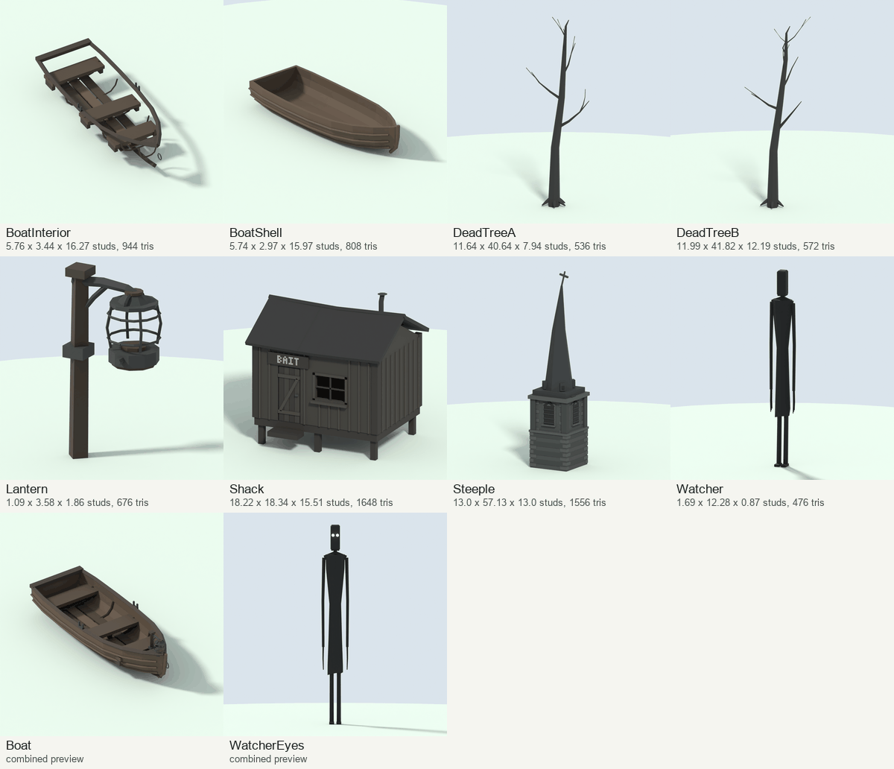

# Art: the hero models (M9)

Eight low-poly meshes made by script in Blender 5.1 (`tools/blender/`), in the palette from `docs/DESIGN.md` and `src/shared/Look.luau`, laid over the part-built versions at server start by `src/server/HeroModels.luau`.



| Model | Covers | Triangles |
|---|---|---|
| BoatShell | The boat's outer planks (no vertex colours: the boat paint colours it) | 808 |
| BoatInterior | Keel, gunwales, ribs, floorboards, thwarts, oarlocks, bow ring | 944 |
| Lantern | The bow post, iron arm and a caged hurricane lamp around the glow | 676 |
| Watcher | The tall figure on the shore (the client lays it over its figure) | 476 |
| Steeple | The sunken steeple (the bell stays a part) | 1556 |
| Shack | The bait shack (the lit window, shelf and radio stay parts) | 1648 |
| DeadTreeA, DeadTreeB | Every dead shoreline tree, scaled to its height | 536, 572 |

## How it fits together

- Each model is authored in the exact frame of the part-built version it covers (see the docstring in `tools/blender/dwb.py`). `art/models/manifest.json` records each mesh's size and bounding-box centre in that frame; the same numbers are in `src/shared/AssetRegistry.luau`.
- The game places a mesh at `frame * CFrame.new(center) * HeroLook.MESH_TURN`. Roblox brings glTF meshes in turned half a turn about the vertical axis, which `MESH_TURN` undoes.
- The covered parts turn see-through (`Transparency = 1`) and keep their collision, so seats, walls, casting and the rules behave exactly as before. A mesh with id 0, or one that fails to load, changes nothing: the part-built version stays visible.
- Meshes load with `AssetService:CreateMeshPartAsync` on the mesh id, with `InsertService:LoadAsset` on the model id as the backup. Both work in the unpublished place in Studio (checked 11/27/2026).

## Rebuild and upload

```powershell
cd "C:\Users\stewa\Documents\Claude\Roblox\dead-calm"; & "C:\Program Files\Blender Foundation\Blender 5.1\blender.exe" -b -P "C:\Users\stewa\Documents\Claude\Roblox\dead-calm\tools\blender\build_all.py"; python "C:\Users\stewa\Documents\Claude\Roblox\dead-calm\tools\blender\contact_sheet.py"; python "C:\Users\stewa\Documents\Claude\Roblox\dead-calm\tools\blender\roblox_colors.py"
```

That writes `art/models/<Name>.glb` and `.fbx`, `art/previews/<Name>.png`, the contact sheet, and `art/models/roblox/<Name>.glb` (vertex colours converted to sRGB, the files that get uploaded). Uploads go through the Fishing Game Studio window's Open Cloud permission only (`open_cloud_invoke`, assets endpoint, asset type Model); log each operation and asset id at once with `tools/blender/log_id.py`. Each upload is a new permanent asset, so re-upload only a model that changed, and update its ids, `center` and `size` in `AssetRegistry.luau` from the new manifest.
